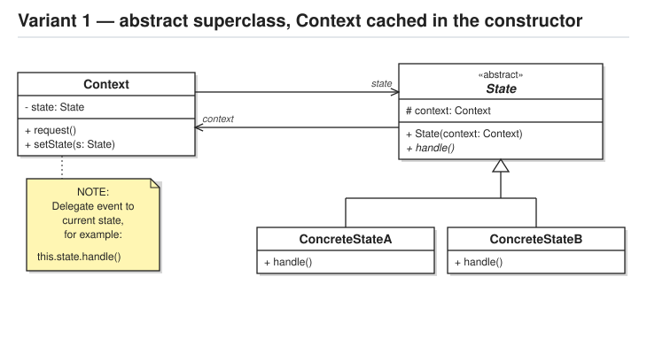
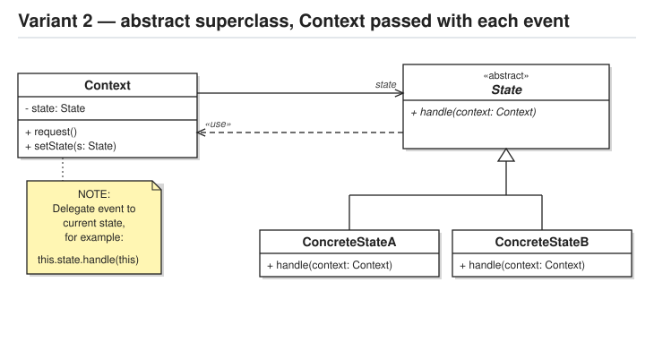
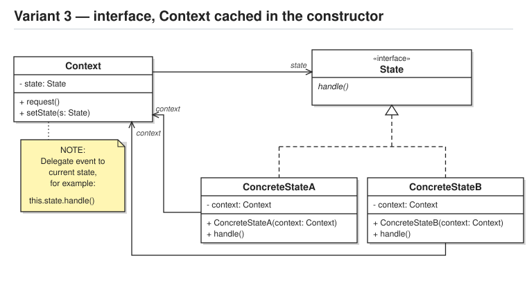
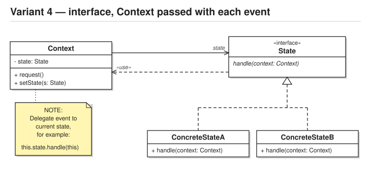

# State pattern samples

TypeScript + Deno samples of the **State design pattern**, one folder per variant.
Each folder has a `question` (README with the state machine diagram + a starter `main.ts`) and a `solution` (Question 1 and Question 2).

| Folder | Variant | Example | Author |
|---|---|---|---|
| [`v1_sample_door`](v1_sample_door/question/README.md) | **V1** - abstract class, Context cached in the state's constructor | Door (open / closed / locked + alarm) | practice test |
| [`v2_sample_traffic_lights`](v2_sample_traffic_lights/question/README.md) | **V2** - abstract class, Context passed with each event | Traffic lights | Dr Matt Smith |
| [`v3_sample_gumball`](v3_sample_gumball/question/README.md) | **V3** - interface, Context cached in the state's constructor | Gumball machine (Head First) | Dr Matt Smith |
| [`v4_sample_ship`](v4_sample_ship/question/README.md) | **V4** - interface, Context passed with each event | Ship (entry actions, completion transitions, guard) | practice test |

The V2 and V3 samples are from Dr Matt Smith's
[2026-design-patterns-sample-lab-test-3](https://github.com/dr-matt-smith/2026-design-patterns-sample-lab-test-3).
The V1 and V4 samples are practice tests written in the same format; the ship statechart is the one Matt left in that repo's `another_state_chart` folder.

## The 4 variants

| | Context cached (`handle()`) | Context as a parameter (`handle(context)`) |
|---|---|---|
| **«abstract» State** (`extends`) |  |  |
| **«interface» State** (`implements`) |  |  |

How to tell them apart from the diagram:
- `«abstract»` → `class XState extends State`, `«interface»` → `class XState implements State`
- `handle()` with empty brackets → **cached**: `new XState(this)`, the state keeps a reference to the Context
- `handle(context: Context)` → **param**: `new XState()`, the Context passes itself: `this.state.handle(this)`

Reading a statechart:
- black dot → initial state (set in the Context's constructor)
- arrow label → event method; no arrow for an event in a state → invalid, just log a message
- `[guard]` → an `if`
- `entry / action` → an `entry()` method, called from `setState()`
- unlabelled arrow → completion transition: `setState(...)` at the end of `entry()`

## Running

From inside any `question` or `solution/questionN` folder:

```bash
deno run src/main.ts     # run the text menu
deno check src/main.ts   # type check (deno run does not type check!)
```

Note: Matt's original V2 solution runs fine but fails `deno check`, because `deno.json` has `noImplicitOverride: true` - with an abstract class whose methods have bodies, each state's method needs the `override` keyword (e.g. `public override goGreen(...)`). Declaring the methods `abstract` in `State` avoids this.
