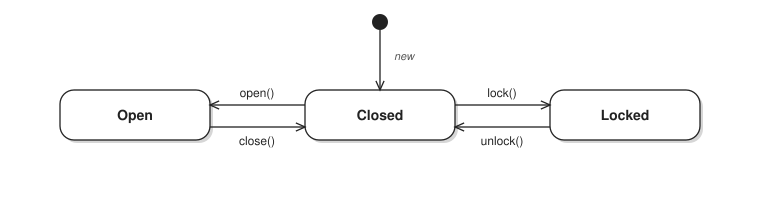
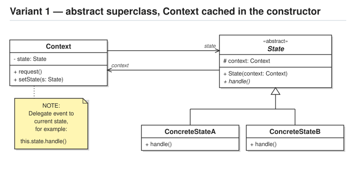

# Question 1

## the state machine diagram to implement

Door state machine diagram



NOTES:
1. Each State object should return its name in CAPS in a `toString()` method
    - e.g.
        ```typescript
        public toString(): string {
            return "CLOSED";
        }
        ```


1. your system should log to the console appropriate messages when each event is processed
    - An event that is valid should change state
        - and print a message saying it's changing to the new state.
    - An event that is NOT valid in the current state must leave the state unchanged
        - and print a message saying why.

    - e.g.
        - `The door opens`
        - `The door is already OPEN`
        - `You can't lock the door while it is OPEN - close it first`


## the state pattern variant to demonstrate



## `main.ts` - sample text-driven menu

You have been provided with a sample main.ts for a text-driven menu to interactively drive your implementation

The terminal output should look something like the following:

```bash
question1 % deno run src/main.ts
---------------------------
State: CLOSED

1 - open
2 - close
3 - lock
4 - unlock
q - quit
> 3
The door is now LOCKED
---------------------------
State: LOCKED

1 - open
2 - close
3 - lock
4 - unlock
q - quit
> 1
You can't open the door - it is LOCKED, unlock it first
---------------------------
State: LOCKED

1 - open
2 - close
3 - lock
4 - unlock
q - quit
>
```

# Question 2

Create a copy of your question 1 project, naming the copy `question2`.
Then in your `question2` project implement the following additional functionality:

- add a new state 'Alarm', used when someone tries to force the door
- add a new event `breakIn()`: from the CLOSED or LOCKED states it moves the door to 'Alarm'
    - from OPEN, `breakIn()` leaves the door OPEN (there is nothing to break - log a message)
- from 'Alarm', `unlock()` moves the door back to CLOSED; every other event leaves it in 'Alarm'
- add a menu option to `main.ts` for the new event
