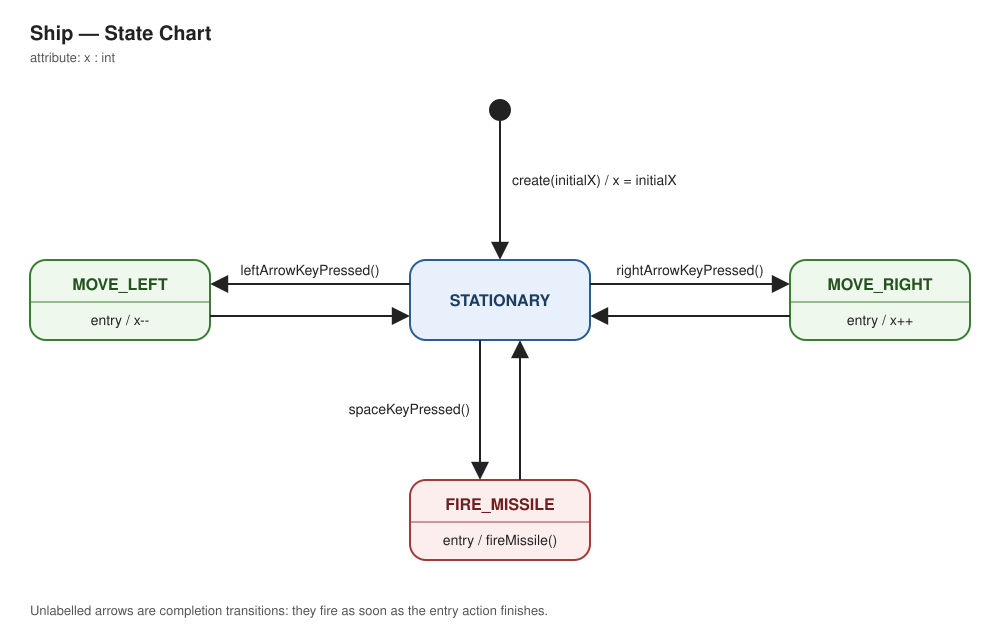
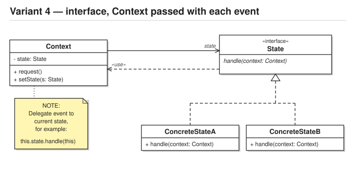

# Question 1

## the state machine diagram to implement

Ship state machine diagram



NOTES:
1. The constructor for the `Ship` class should accept an integer, which is the initial value of `x`
    - e.g. `const ship = new Ship(5);`

1. Each State object should return its name in CAPS in a `toString()` method
    - e.g.
        ```typescript
        public toString(): string {
            return "STATIONARY";
        }
        ```

1. **entry actions** - every State should have an `entry()` method, which is run each time the ship enters that state
    - a state with no entry action on the diagram should just log a message, e.g. `(no actions for entry event)`

1. **completion transitions** - the unlabelled arrows have no event: as soon as the entry action has finished, the ship goes straight back to `STATIONARY`

1. `fireMissile()` should be a method of the `Ship` class that just logs a message, e.g. `*** missile fired from x = 5 ***`

1. your system should log to the console appropriate messages when each event is processed
    - An event that is valid should change state
        - and print a message saying it's changing to the new state.
    - An event that is NOT valid in the current state must leave the state unchanged
        - and print a message saying why.

    - e.g.
        - `Changing from STATIONARY to MOVE_LEFT`
        - `Ship moves left, x is now 4`
        - `Changing from MOVE_LEFT to STATIONARY`


## the state pattern variant to demonstrate



## `main.ts` - sample text-driven menu

You have been provided with a sample main.ts for a text-driven menu to interactively drive your implementation

The terminal output should look something like the following:

```bash
question1 % deno run src/main.ts
---------------------------
State: STATIONARY
x: 5

1 - left arrow key
2 - right arrow key
3 - space key (fire)
q - quit
> 1
Changing from STATIONARY to MOVE_LEFT
Ship moves left, x is now 4
Changing from MOVE_LEFT to STATIONARY
(no actions for entry event)
---------------------------
State: STATIONARY
x: 4

1 - left arrow key
2 - right arrow key
3 - space key (fire)
q - quit
> 3
Changing from STATIONARY to FIRE_MISSILE
*** missile fired from x = 4 ***
Changing from FIRE_MISSILE to STATIONARY
(no actions for entry event)
---------------------------
State: STATIONARY
x: 4

1 - left arrow key
2 - right arrow key
3 - space key (fire)
q - quit
>
```

# Question 2

Create a copy of your question 1 project, naming the copy `question2`.
Then in your `question2` project implement the following additional functionality:

- add a new attribute `missiles: int` to the `Ship` - a new ship starts with 3 missiles
- `spaceKeyPressed()` now has a **guard**: `spaceKeyPressed() [missiles > 0]`
    - IF the ship has missiles THEN it goes to `FIRE_MISSILE` as before, and the entry action is now `entry / fireMissile(); missiles--`
    - IF `missiles == 0` THEN there is no change of state, and a message is logged, e.g. `Out of missiles - press R to reload`
- add a new state `RELOAD`, with the entry action `entry / missiles = 3`
    - a new event `reloadKeyPressed()` moves the ship from `STATIONARY` to `RELOAD`
    - like the other moving states, `RELOAD` has a completion transition straight back to `STATIONARY`
- add a menu option `4 - R key (reload)` to `main.ts`, and show the number of missiles in the status
